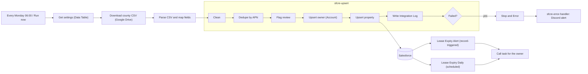

# Case Study: Salesforce CRE Data Hub

**County property records are loaded into Salesforce every week as clean, de-duplicated owners and properties. Leases close to expiry become call tasks for a broker, who logs each call from the property page.**

   

| | |
|---|---|
| **Type** | Portfolio build (a reference implementation, not a client engagement) |
| **My role** | Sole designer and builder of every part: the Salesforce data model and security, record-triggered and scheduled Flows, the n8n ingest and upsert pipeline, the data cleaning rules, and the reports and dashboard |
| **Scale** | 3 n8n workflows (22 nodes); 4 custom objects, plus custom fields on Account and Opportunity; 3 Flows; 3 permission sets; 4 reports and 1 dashboard |
| **Stack** | Salesforce (SFDX, Flow Builder, duplicate and matching rules), n8n, Google Drive, n8n Data Tables, Discord |
| **Status** | Tested on a 300-row synthetic county file and 60 synthetic leases in a Salesforce Developer org (results below). It has not been run on real county data. |
| **Results** | 290 of 290 unique parcels saved with their owners (synthetic). All 18 rows with planted problems were flagged for review. The second run created 0 new records. |

---

## The problem
Commercial real estate brokers find prospects in county assessor exports. These files repeat parcels and spell the same owner several ways, such as "Acme Holdings, L.L.C." and "ACME HOLDINGS LLC". They also mix bad phone numbers and ZIP+4 codes into the data. Importing them into a CRM by hand creates duplicate owners. The most useful signal, a tenant whose lease ends soon, gets lost in the noise.

## Outcome
- Each parcel is keyed by its APN and each owner by a cleaned-up owner key. Running a file again updates the existing records instead of creating duplicates.
- A row is saved but flagged with a reason when it has no owner, no mailing address, a bad phone number or no valid ZIP code. No row is dropped silently.
- Each run writes one Integration Log record with counts and a status: `Success`, `Partial` or `Failed`. If a run saves no properties, it stops with an error and posts an alert.
- Each lease that ends within 365 days gets a priority and a call task on the owner's account. The priority is Hot when the lease ends within 180 days and Warm otherwise.
- On the synthetic test file, all 290 unique parcels were saved, 18 were flagged for review, and there were 0 errors.

---

## Architecture

### Stage by stage
| Step | Stage | What it does | Why it is built this way |
|---|---|---|---|
| 1 | `sfcre-ingest` | Runs every Monday at 06:00, or by hand. Reads the file id from a settings table, then downloads and parses the CSV. Maps the county columns to 17 neutral fields and gives the whole run one `batch_id`. | The source file and the alert channel are settings, not hard-coded values. A new county only needs a new settings row. |
| 2 | `sfcre-upsert`: Clean | Builds `owner_key`, a clean owner name, an entity flag, an E.164 phone number, a 5-digit ZIP code and a standardized street. | All cleaning happens in one Set node of expressions, so it is easy to read and test. |
| 3 | Dedupe and Flag review | Drops repeated APNs within the batch. Then sets `review_reason` and `needs_review` from four checks. | Rows with problems are still useful leads, so they are marked instead of discarded. |
| 4 | Upsert owner and Upsert property | Upserts Accounts on `Owner_Key__c` and Property records on `APN__c`. If one item fails, the others continue. | Upserting by external ID makes each run idempotent, and one bad row does not stop the batch. |
| 5 | Build summary and Write log | Counts rows, saved records, review flags and errors. Upserts an Integration Log record on `Batch_Id__c`. | The log is a Salesforce record, so run history appears in a report and on the dashboard. |
| 6 | Failed? and Stop | If no property was saved, the run stops with an error message that includes a sample of the errors. | A stopped run triggers the error workflow. A partial run finishes normally with status `Partial`. |
| 7 | `sfcre-error-handler` | Starts from an Error Trigger and reads the alert channel from settings. Posts the workflow name, failing node, error message and execution link to Discord. | One handler covers every workflow in the project. |
| 8 | Salesforce Flows | `Lease Expiry Alert` sets the priority and creates a task when a lease is saved. `Lease Expiry Daily` checks leases again each day, moving blank to Hot or Warm and Warm to Hot. `Log a Call` is a screen Flow on the Property page. | The priority changes as the end date gets closer, not only when someone edits the record. |

---

## Deep dives

### Owner key: one owner, many spellings
The `owner_key` formula:
- converts the name to upper case and removes `.` and `,`;
- drops legal suffixes: `LLC`, `INC`, `CORP`, `CO`, `LP`, `LLP`, `LTD`, `TRUST`;
- turns any other symbol into a space and joins the words with `-`.

"Acme Holdings, L.L.C." and "acme holdings llc" both become `ACME-HOLDINGS`. A blank name becomes `UNKNOWN-OWNER`, which links to a single seeded "Unknown Owner" account. In Salesforce, a matching rule and a duplicate rule on `Owner_Key__c` stop anyone from creating the same owner by hand.

### Review flags
`review_reason` lists every check the row fails:
- `no owner`
- `no mailing address`
- `bad phone`: a phone number was given, but cleaning left nothing usable
- `bad zip`: no run of 5 digits

`needs_review` is true when that list is not empty. Both fields are written to the Property record and feed the "Properties Needing Review" report.

### Run status
`errors` is the number of failed owner upserts plus the number of failed property upserts. The status is:
- `Success` when there are 0 errors;
- `Failed` when no property was saved;
- `Partial` in every other case.

`error_sample` keeps the codes and messages of the first three errors.

---

## Decision log

### Decision 1: Upsert by external ID instead of search-then-create
- **Options:** look up each record and then insert or update it, or upsert on an external ID.
- **Chose:** upsert on `APN__c` and `Owner_Key__c`.
- **Cost or safeguard:** the key rules must stay stable. They live as expressions in one node, and the test data generator uses the same rules to build and check its data.

### Decision 2: Salesforce Flows for lease priority, n8n for ingest
- **Options:** compute the priority in n8n during import, or in Salesforce.
- **Chose:** Salesforce. People enter leases by hand as well as through imports, and the priority has to change as dates get closer.
- **Cost or safeguard:** a scheduled Flow checks open leases again every day.

### Decision 3: Only the owner-key duplicate rule is active
- **Options:** keep Salesforce's standard fuzzy Account duplicate rule, or rely on the owner key alone.
- **Chose:** the owner key alone. The fuzzy rule blocks API saves of different owners that have similar names, even when the rule is set to alert only.
- **Cost or safeguard:** two different owners would merge if their names cleaned to the same key. The key keeps every word except legal suffixes, so this only happens when the names are otherwise identical.

---

## Failure modes I designed for
| What goes wrong | What happens |
|---|---|
| The same parcel appears twice in a file | The repeat is removed in the batch. Upserting on APN also covers repeats across files. |
| One owner is spelled several ways | Every spelling gets the same `owner_key`, so there is one Account. |
| The owner is blank | The parcel links to "Unknown Owner" and is flagged `no owner`. |
| The phone number or ZIP code is bad | A bad phone number is left empty and flagged. A ZIP+4 code is trimmed to 5 digits. |
| Salesforce rejects one row | The other rows continue. The run is marked `Partial` with an error sample. |
| Nothing is saved | The run is marked `Failed`, stops with an error and sends a Discord alert. |
| The file is missing or the download fails | The workflow errors and the error workflow sends a Discord alert. |

## Data model
| Object | Purpose and fields used |
|---|---|
| Account (owner) | `Owner_Key__c` (external ID), `Is_Entity__c`, `Needs_Review__c`, `Source__c` |
| `Property__c` | `APN__c` (external ID), street, city, state, ZIP, property type, building square feet, year built, owner, `Needs_Review__c`, `Review_Reason__c`, `Last_Synced__c` |
| `Lease__c` | property, tenant, start date, end date, monthly rent, `Prospect_Priority__c` (Hot or Warm) |
| `Comp__c` | property, sale date, sale price, price per square foot |
| `Integration_Log__c` | batch id (external ID), rows in, rows after dedupe, accounts saved, properties saved, review count, errors, error sample, status, start and finish times |
| Opportunity | a `Property__c` lookup and CRE stage values |

Access is controlled by three permission sets: `CRE Broker`, `CRE Data Team` and `CRE Manager`.

## Testing and verification

**How it was tested.** [`samples/gen_county.py`](samples/gen_county.py) generated the synthetic data with a fixed seed. The county file has 300 rows: 290 unique parcels plus 10 exact duplicate APNs.

The generator planted these problem cases before any run:
- 6 owners spelled 2 to 4 ways across 20 parcels
- 5 blank owners
- 5 blank mailing addresses
- 8 bad phone numbers
- 5 ZIP+4 codes
- 3 spellings of one street

The generator also computed the expected results with the same rules: 290 rows after dedupe and 18 rows flagged for review.

The file went through `sfcre-ingest` once into a Salesforce Developer org, then a second time unchanged. To test the Flows, 60 synthetic leases were bulk-loaded. 15 of them end within 365 days, and 5 of those within 180 days.

| Measure | First run | Second run (same file) |
|---|---|---|
| Rows in / after dedupe | 300 / 290 | 300 / 290 |
| Owners saved | 290 of 290 rows | 290 of 290 rows |
| Properties saved | 290 of 290 | 290 of 290 |
| Flagged for review | 18 of 290 (18 expected) | 18 of 290 |
| Errors | 0 | 0 |
| Records in the org after the run | 290 properties, 272 accounts | 290 properties, 272 accounts (0 new) |
| Run time | about 3.9 minutes | |

| Alert test (scheduled stand-in, missing Drive file) | Result |
|---|---|
| Download failed and the error workflow ran | 1 of 1 |
| Discord message had workflow name, node, message and link | 1 of 1 |

| Lease test | Result |
|---|---|
| Leases ending within 365 days that got a priority and a task | 15 of 15 (5 Hot, 10 Warm) |

The 20 parcels with variant owner spellings ended up on 6 Accounts. The 5 parcels with blank owners ended up on the single "Unknown Owner" Account.

### What did not go perfectly
- **The alert path was checked with a stand-in workflow.** n8n does not send failures from manual runs to the error workflow. So a scheduled stand-in workflow ran the same Google Drive download on a missing file id. The download failed with "File not found", and `sfcre-error-handler` posted one Discord message with the workflow name, the failing node, the error message and the execution link. `sfcre-ingest` itself has not failed on a scheduled run.
- **The daily lease Flow** is deployed and active, but it had not reached its first scheduled run during testing. The record-triggered Flow applies the same rules and was tested on all 60 leases.
- **Scope.** Synthetic data, one Developer org and one run per case. Treat these results as a regression baseline, not a measure on real county data.

## Configuration and swap-ins
Everything below is a setting or a node swap, not a rewrite.

| What | Default here | Change it to |
|---|---|---|
| Source file | Google Drive file id in the settings table (`county_file_id`) | Another file id. You can also swap the Download node for S3, SFTP or an HTTP request. |
| Schedule | Monday 06:00 | Any Schedule Trigger rule |
| Column mapping | `Map county fields`, which reads the county export headers | Another county's headers. The 17 output fields stay the same. |
| Alerts | Discord server and channel ids in the settings table (`discord_guild_id`, `discord_channel_id`) | A Slack, email or Teams node in `sfcre-error-handler` |
| Lease thresholds | 180 days for Hot, a 365-day window, tasks due in 3 days | The `fPriority`, `fLimit365` and `fDue` formulas in the Flows |

## Skills used
- **Salesforce data modelling**: custom objects, lookups, external IDs, matching and duplicate rules, permission sets
- **Flow Builder**: record-triggered, scheduled and screen Flows
- **Salesforce DX**: source-driven metadata deployed with the Salesforce CLI, Bulk API data loads
- **n8n integration**: Salesforce upserts by external ID, sub-workflows, an error workflow, Data Table settings
- **Data cleaning**: entity-name normalisation, phone and ZIP code rules, de-duplication within a batch
- **Reporting**: summary reports and a dashboard for run history, the review queue and the lease pipeline

## Repository
| File | Purpose |
|---|---|
| `force-app/` | Salesforce metadata: objects, fields, Flows, layouts, permission sets, app, reports, dashboard, rules |
| `data/Account-seed.json` | Seeds the "Unknown Owner" account |
| `workflows/sfcre-ingest.json` | Schedule, download, parse, map, call the upsert workflow |
| `workflows/sfcre-upsert.json` | Clean, dedupe, flag, upsert, log |
| `workflows/sfcre-error-handler.json` | Error Trigger to Discord alert |
| `samples/` | The test data generator and the synthetic county and lease files it produced |

### Run it yourself
1. **Deploy the Salesforce metadata** to a Developer org.
   - In the dashboard file, replace `REPLACE_WITH_ORG_USERNAME` with the org user the dashboard runs as.
   - Deploy: `sf project deploy start --source-dir force-app`
   - Load the seed account: `sf data import tree --files data/Account-seed.json`
2. **Set up access.** Assign the permission sets. If the standard Account duplicate rule blocks API saves of owners with similar names, turn it off.
3. **Import the workflows** into n8n. All of them are exported **inactive**.
   - Replace `YOUR_DATA_TABLE_ID` and every `WORKFLOW_ID_*`.
   - Re-select the Salesforce, Google Drive and Discord credentials.
   - Set `sfcre-error-handler` as the Error workflow of the other two.
4. **Create the settings table:** a Data Table with one row holding `county_file_id` (the Drive file id of the CSV), `discord_guild_id` and `discord_channel_id`.
5. **Run a test.**
   - Upload `samples/county-records.csv` to Drive.
   - Run `sfcre-ingest` with **Run now**.
   - Load the leases: `sf data import bulk --sobject Lease__c --file samples/leases.csv --line-ending CRLF`

All names, addresses, phone numbers and APNs are fictional demo data. MIT licensed.
